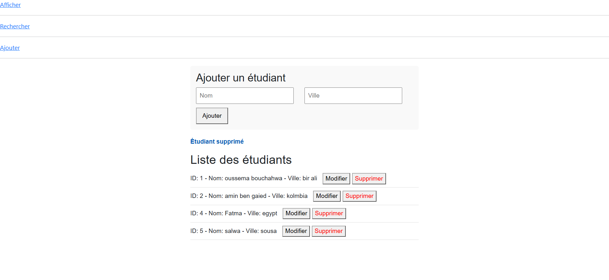
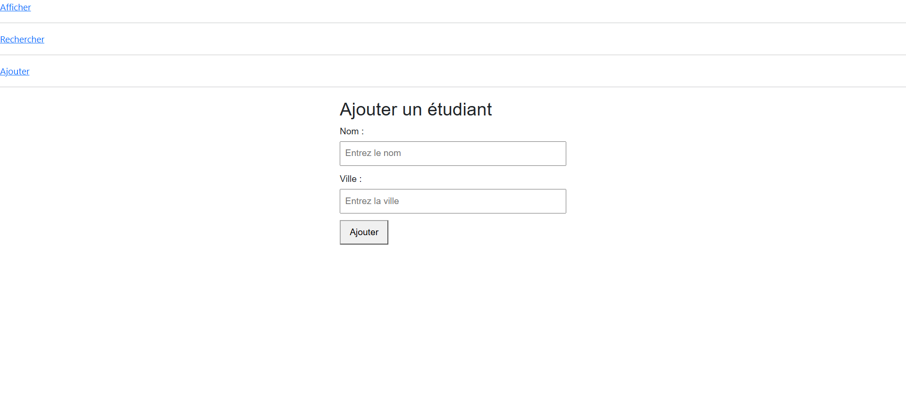
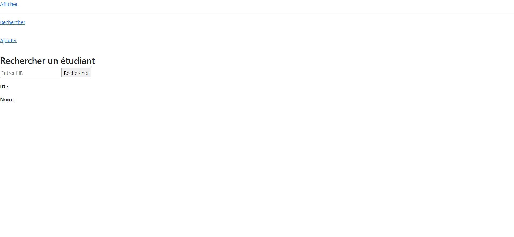

# 🎓 TP4 : Gestion des Étudiants (Full-Stack CRUD)

[](https://angular.dev/)
[](https://nodejs.org/)
[](https://expressjs.com/)
[](https://www.mysql.com/)
[](https://www.typescriptlang.org/)

Application web complète de gestion d'étudiants développée dans le cadre des travaux pratiques (**TP4 - 2ème Année**). Le projet met en œuvre une architecture client-serveur moderne avec une API REST en **Node.js / Express**, une base de données relationnelle **MySQL** et une interface utilisateur réactive en **Angular 18**.

---

## 📌 Sommaire

- [Aperçu du Projet](#-aperçu-du-projet)
- [Fonctionnalités Principales](#-fonctionnalités-principales)
- [Captures d'Écran](#-captures-décran)
- [Architecture & Structure](#-architecture--structure)
- [Technologies Utilisées](#-technologies-utilisées)
- [Prérequis](#-prérequis)
- [Configuration de la Base de Données](#-configuration-de-la-base-de-données)
- [Installation et Démarrage](#-installation-et-démarrage)
  - [1. Backend (Serveur API)](#1-démarrage-du-backend)
  - [2. Frontend (Application Angular)](#2-démarrage-du-frontend)
- [Documentation de l'API REST](#-documentation-de-lapi-rest)

---

## 🚀 Aperçu du Projet

Ce TP illustre la mise en place d'un cycle complet de données (**CRUD**) :
1. **Création** : Enregistrement de nouveaux étudiants avec nom et ville.
2. **Lecture** : Affichage dynamique de la liste complète et recherche par identifiant unique (ID).
3. **Mise à jour** : Modification en temps réel des informations d'un étudiant existant.
4. **Suppression** : Suppression sécurisée d'un étudiant de la base de données.

---

## ✨ Fonctionnalités Principales

- **Composants Standalone (Angular 18)** : Utilisation de la nouvelle syntaxe de contrôle de flux (`@if`, `@for`, `@empty`).
- **Communication HTTP asynchrone** : Échanges de données via le module `HttpClient` d'Angular et Observables RxJS.
- **Routage Angular** : Navigation fluide entre les différentes vues (`/afficher`, `/ajouter`, `/rechercher`).
- **Liaison bidirectionnelle (Two-Way Binding)** : Formulaires pilotés par `[(ngModel)]`.
- **API REST robuste** : Middleware `cors` configuré pour autoriser les requêtes cross-origin du client Angular.

---

## 📸 Captures d'Écran

### 1. Affichage et Gestion Complète (CRUD)
Cette interface permet de lister l'ensemble des étudiants stockés dans MySQL, de pré-remplir le formulaire pour modification, d'ajouter directement un nouvel enregistrement et de supprimer une entrée avec confirmation.



---

### 2. Formulaire d'Ajout d'un Étudiant
Une page dédiée permettant d'insérer un nouvel étudiant (Nom et Ville) avec validation et message de retour en temps réel.



---

### 3. Recherche par Identifiant (ID)
Module de recherche ciblée permettant d'interroger l'API `/etudiants/:id` pour récupérer et afficher instantanément les coordonnées d'un étudiant précis.



---

## 📂 Architecture & Structure

```plaintext
TP4/
├── api/                           # Application Frontend Angular 18
│   ├── src/
│   │   ├── app/
│   │   │   ├── afficher/          # Composant liste, modification et suppression
│   │   │   │   ├── afficher.component.ts
│   │   │   │   ├── afficher.component.html
│   │   │   │   └── afficher.component.css
│   │   │   ├── ajouter/           # Composant formulaire d'ajout
│   │   │   │   ├── ajouter.component.ts
│   │   │   │   ├── ajouter.component.html
│   │   │   │   └── ajouter.component.css
│   │   │   ├── recherche/         # Composant recherche par ID
│   │   │   │   ├── recherche.component.ts
│   │   │   │   ├── recherche.component.html
│   │   │   │   └── recherche.component.css
│   │   │   ├── app.component.html # Barre de navigation principale
│   │   │   ├── app.component.ts
│   │   │   └── app.routes.ts      # Définition des routes Angular
│   │   ├── index.html
│   │   └── styles.css
│   ├── angular.json
│   └── package.json
│
├── backend/                       # Serveur Backend Node.js / Express
│   ├── package.json
│   └── server.js                  # Configuration Express, connexion MySQL & Endpoints REST
│
├── scrine/                        # Captures d'écran de démonstration
│   ├── afficher.png
│   ├── ajouter.png
│   └── recherech.png
│
└── README.md                      # Documentation du projet
```

---

## 🛠️ Technologies Utilisées

| Rôle | Technologie | Description |
| :--- | :--- | :--- |
| **Frontend** | [Angular 18](https://angular.dev/) | Framework TypeScript pour interfaces web SPA réactives |
| **Backend** | [Node.js](https://nodejs.org/) & [Express 5](https://expressjs.com/) | Serveur HTTP et gestion des routes d'API REST |
| **Base de Données** | [MySQL](https://www.mysql.com/) | SGBD relationnel pour la persistance des données |
| **Pilote BD** | [mysql (npm)](https://www.npmjs.com/package/mysql) | Connecteur Node.js pour MySQL |
| **Communication** | [HttpClient](https://angular.dev/guide/http) & [CORS](https://www.npmjs.com/package/cors) | Échanges de données JSON sécurisés entre ports |

---

## 📋 Prérequis

Avant de lancer le projet, assurez-vous d'avoir installé sur votre machine :
- **Node.js** (version 18 ou supérieure recommandée) et **npm** : [Télécharger Node.js](https://nodejs.org/)
- **Angular CLI** :
  ```bash
  npm install -g @angular/cli
  ```
- Un serveur MySQL local tel que **XAMPP**, **WampServer**, ou le service natif **MySQL Server**.

---

## 🗄️ Configuration de la Base de Données

1. Démarrez votre serveur MySQL (ex: via le panneau de contrôle **XAMPP** ou **WampServer**).
2. Ouvrez **phpMyAdmin** ou votre client MySQL préféré (`http://localhost/phpmyadmin`).
3. Créez la base de données et la table en exécutant le script SQL suivant :

```sql
-- 1. Création de la base de données
CREATE DATABASE IF NOT EXISTS test CHARACTER SET utf8mb4 COLLATE utf8mb4_unicode_ci;

-- 2. Sélection de la base
USE test;

-- 3. Création de la table 'etudiant'
CREATE TABLE IF NOT EXISTS etudiant (
    id INT AUTO_INCREMENT PRIMARY KEY,
    nom VARCHAR(100) NOT NULL,
    ville VARCHAR(100) NOT NULL
);

-- 4. Jeu d'essai initial (Optionnel)
INSERT INTO etudiant (nom, ville) VALUES 
('Ahmed Ben Ali', 'Tunis'),
('Sarra Trabelsi', 'Sousse'),
('Youssef Gharbi', 'Sfax');
```

> [!NOTE]
> Les identifiants de connexion par défaut dans `backend/server.js` sont :
> - **Host** : `localhost`
> - **User** : `root`
> - **Password** : *(vide)*
> - **Database** : `test`

---

## ⚙️ Installation et Démarrage

### 1. Démarrage du Backend

Ouvrez un terminal dans le répertoire racine du projet :

```bash
# Accéder au dossier backend
cd backend

# Installer les dépendances (si ce n'est pas déjà fait)
npm install

# Lancer le serveur Express
node server.js
```

Le serveur démarrera sur **`http://localhost:3001`** et affichera :
```plaintext
Connecté à la base de données MySQL
Serveur Express en cours d'exécution sur le port 3001
```

---

### 2. Démarrage du Frontend

Ouvrez un second terminal :

```bash
# Accéder au dossier frontend
cd api

# Installer les dépendances
npm install

# Démarrer le serveur de développement Angular
ng serve --open
```

L'application s'ouvrira automatiquement dans votre navigateur à l'adresse **`http://localhost:4200`**.

---

## 📡 Documentation de l'API REST

Le serveur backend expose les endpoints suivants sur le port `3001` :

| Méthode | Route | Description | Corps de requête (JSON) | Code Succès |
| :---: | :--- | :--- | :--- | :---: |
| **GET** | `/etudiants` | Récupère tous les étudiants | Aucun | `200 OK` |
| **GET** | `/etudiants/:id` | Récupère un étudiant par son ID | Aucun | `200 OK` / `404` |
| **POST** | `/ajouter` | Ajoute un nouvel étudiant | `{"nom": "string", "ville": "string"}` | `200 OK` |
| **PUT** | `/modifier/:id` | Modifie les données d'un étudiant | `{"nom": "string", "ville": "string"}` | `200 OK` / `404` |
| **DELETE** | `/supprimer/:id` | Supprime un étudiant de la base | Aucun | `200 OK` / `404` |

---

## 👨‍💻 Auteur

- **Projet TP4** - 2ème Année Informatique / Développement Web & Frameworks
- Développé avec **Angular 18** et **Node.js / Express**
